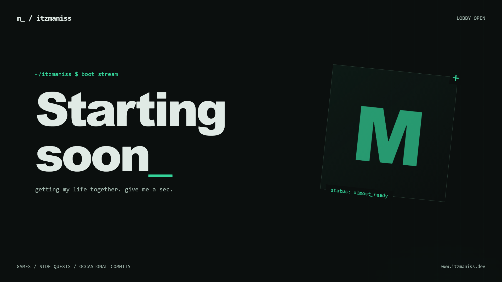

# itzmaniss / Terminal Lab

My OBS setup, Twitch branding, and local stream widgets. Mainly games; coding and shareable QutriLabs projects are occasional side quests.



## After reinstalling Windows

1. Download this repo with **Code > Download ZIP** and extract it, or clone it with Git.
2. Close OBS if it is running.
3. Double-click **`SETUP-OBS.cmd`**. Complete any Windows installer permission or winget first-run prompts.
4. In OBS, connect Twitch under **Settings > Stream**. Check the microphone, choose your camera in **Camera · optional > Properties**, and test game capture with the game open.

The script installs OBS if needed using the OBS Project's [documented winget package](https://obsproject.com/kb/windows-installation). Windows App Installer / winget and internet access are required for that install. If winget is unavailable, install [OBS](https://obsproject.com/download) first and run the same script again. No Git, Node, Python, or third-party OBS plugins are required to restore from a ZIP.

It restores 13 scenes, local assets, a separate **itzmaniss - Terminal Lab** output profile, and an **OBS - Terminal Lab** desktop shortcut. OBS opens on Starting Soon. Launching uses OBS's [profile and collection parameters](https://obsproject.com/kb/launch-parameters/); the script does not start streaming, recording, or the virtual camera.

Assets are copied to `%LOCALAPPDATA%\itzmaniss-stream\terminal-lab`. The extracted download can be moved or deleted after setup; OBS keeps using that installed copy. The profile uses 1920 × 1080 at 60 fps, 48 kHz stereo, 6000 kbps streaming, MKV recording, five recording tracks, and the existing separate Twitch VOD mix. NVIDIA hardware selects NVENC; other systems use x264. Adjust output settings if the new machine or connection needs something different.

Twitch sign-in, stream keys, private alert URLs, and hardware device IDs are not in Git. On a fresh Windows install, connect Twitch, optionally reconnect your alert provider, and select your devices once. The microphone initially uses Windows' default input. The camera's own audio is muted.

## Re-running setup and backups

Setup refuses to write while OBS is open. It changes only this pack's named collection, profile, asset folder, and desktop shortcut; other profiles and collections stay in place. On repeated runs it preserves the installed camera, microphone, private alert URL, and profile account/service settings.

Before updating an existing installation, it copies the previous assets, scene collection, and profile to `%LOCALAPPDATA%\itzmaniss-stream\backups\<timestamp>`. Those backups stay local and may contain account configuration. To roll back with OBS closed, copy the backed-up JSON into `%APPDATA%\obs-studio\basic\scenes`, the backed-up `profile` contents into `%APPDATA%\obs-studio\basic\profiles\itzmaniss-terminal-lab`, and the backed-up `assets` contents into the installed asset folder.

Optional PowerShell arguments:

```powershell
# Custom OBS install location, or CPU encoding instead of automatic NVIDIA selection:
.\setup\Install-TerminalLab.ps1 -ObsPath 'D:\Program Files\obs-studio\bin\64bit\obs64.exe' -Encoder Software

# Restore without opening OBS afterward:
.\setup\Install-TerminalLab.ps1 -NoLaunch
```

## Scenes and audio

| Scene | Purpose |
| --- | --- |
| 01 · Starting Soon | Subtle animated background and original chill loop; no countdown |
| 02 · Just Chatting | Voice-only lounge with chat |
| 03 · Just Chatting + Camera | Lounge with optional camera |
| 10–15 · Game scenes | Valorant, Fortnite, GTA Online, Weekend Chill, How to Fish, BOMBANANA! |
| 20 · Dev & Chill | Editor capture and project-night layout |
| 21 · Build + Camera | Editor capture with optional camera |
| 90 · Be Right Back | Matching BRB screen |
| 99 · Ending | Matching end screen |

Game scenes have a hidden **Camera · optional** source; toggle its eye to include it. The camera deactivates when hidden. Specific game captures retain their executable matching; select a new game in the source properties when needed. Dev capture targets VS Code. Discord audio is optional.

| Audio track | Contents |
| --- | --- |
| 1 | Live full mix |
| 2 | Microphone |
| 3 | Game |
| 4 | Discord |
| 5 | Original music |
| 6 | Twitch VOD mix, excluding the music track |

Existing scene hotkeys use **Ctrl + Alt + 1–8**: Starting, Chatting, Valorant, Fortnite, GTA Online, Dev, BRB, Ending. Streaming and recording have no automatic start hotkey in this pack.

## Assets and editing

Mint `#34D399`, charcoal `#0B0F0E`, warm white `#E0EAE5`, a subtle grid, and restrained motion. HTML backgrounds and `brand.css` are editable; PNG files are static exports. No external fonts are needed.

| Files | Use |
| --- | --- |
| `starting`, `brb`, `ending`, `lounge`, `lounge-camera`, `dev` | OBS layouts, HTML + 1920 × 1080 PNGs |
| `game-overlay.png`, `minimap-cover.png` | Transparent name badge and minimap cover |
| `avatar.png`, `twitch-banner.png`, `offline.png` | Twitch avatar, profile banner, offline banner |
| `panel-*.png`, `channel-copy.md` | Three Twitch panels and channel copy |
| `browser/` | Local chat widget, anonymous read-only Twitch connection |
| `media/` | Original chill loop and transition video |
| `obs/scene-collection.template.json` | Portable scene definitions; setup resolves the asset placeholders |
| `obs/profile.basic.ini.in` | Output profile template |
| `obs/asset-manifest.json` | Asset allowlist and SHA-256 hashes |

After intentionally editing assets, run `setup\Update-AssetManifest.ps1`, then rerun setup with OBS closed to refresh the installed copy. Commit the changed assets and manifest together. The manifest detects incomplete or changed assets before setup writes to OBS.

Channel links are the [portfolio](https://www.itzmaniss.dev) and [GitHub](https://github.com/itzmaniss). QutriLabs and MyRideSG website links are deferred. Twitch's already-published channel settings live on Twitch and are not re-uploaded by this installer.

## Verification

Run `tests\Test-Setup.ps1` in Windows PowerShell 5.1. It restores into an isolated test directory and checks asset paths, all 13 scenes, output profiles, repeat-run backups, local device/account preservation, and rejection of incomplete downloads. It never installs or opens OBS and never writes to the real OBS settings. GitHub Actions runs the same checks on Windows.

A complete restore on a freshly wiped Windows machine, the winget install branch, camera framing, and live game/mic capture still need a real pre-stream check.
